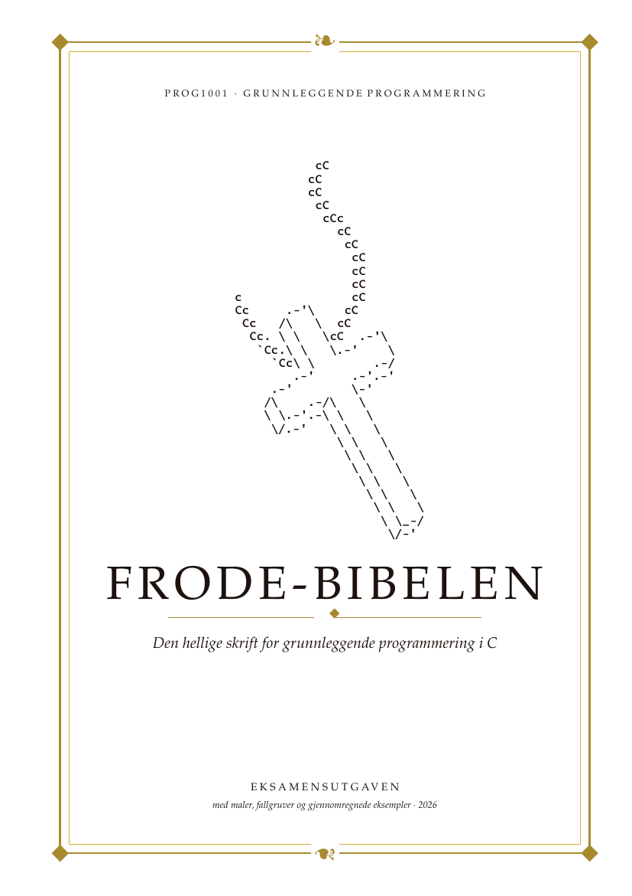

# Frode-bibelen

**Et uoffisielt oppslagsverk i LaTeX til skoleeksamen i PROG1001 Grunnleggende programmering (C) ved NTNU.**

På eksamen i PROG1001 er alle trykte og skrevne hjelpemidler tillatt. Frode-bibelen er laget for å skrives ut, settes i en perm og ligge ved siden av deg i de fire timene. Den samler alt du trenger å slå opp i én bok: maler for oppgave 2 i Frodes stil, feller og metode for «Hva blir utskriften?» i oppgave 1, og en oversikt over alle eksamenene fra H19 til S26.

<p align="center">
  
</p>

```
           cC
          cC
          cC
           cC
            cCc
              cC
               cC
                cC
                cC
                cC
c               cC
Cc     .-'\    cC
 Cc   /\   \  cC
  Cc. \ \   \cC  .-'\
   `Cc.\ \   \.-'    \
     `Cc\ \        .-/
        .-'     .-'.-'
     .-'        \-'
    /\    .-/\   \
    \ \.-'.-\ \   \
     \/.-'   \ \   \
              \ \   \
               \ \   \
                \ \   \
                 \ \   \
                  \ \   \
                   \ \   \
                    \ \_-/
                     \/-'
```

## Innhold

Bibelen følger eksamen: etter kapittel 1 kommer **Del 1** med alt du trenger til oppgave 1, og **Del 2** med alt til oppgave 2. Hver del har sin egen skilleside og slutter med sin egen sjekkliste.

| Kap. | Tittel | Fil |
|---|---|---|
| 1 | Eksamen: format og strategi | `kapitler/01-eksamen.tex` |
| | **Del 1 – Oppgave 1: «Hva blir utskriften?» (30 %)** | |
| 2 | Oppgave 1: «Hva blir utskriften?» | `kapitler/02-oppgave1.tex` |
| 3 | C-grunnlag: oppslag | `kapitler/03-c-grunnlag.tex` |
| 4 | Tekster (`char`-arrayer og `char*`) | `kapitler/04-tekster.tex` |
| 5 | Funksjoner og parametre | `kapitler/05-funksjoner.tex` |
| 6 | ASCII-tabell (tegn 32–126) | `kapitler/06-ascii.tex` |
| 7 | Sjekkliste – oppgave 1 | `kapitler/07-sjekkliste-oppgave1.tex` |
| 8 | Sporingsark (tre like ark) | `kapitler/08-sporingsark.tex` |
| | **Del 2 – Oppgave 2: det store menystyrte programmet (70 %)** | |
| 9 | Programskjelettet i Frodes stil | `kapitler/09-skjelett.tex` |
| 10 | `LesData.h` – verktøykassen | `kapitler/10-lesdata.tex` |
| 11 | Struct, pekere og memory | `kapitler/11-struct-pekere.tex` |
| 12 | Maler: standardoperasjoner i oppgave 2 | `kapitler/12-maler.tex` |
| 13 | Filer | `kapitler/13-filer.tex` |
| 14 | Lenket liste (LIFO/FIFO) | `kapitler/14-lenket-liste.tex` |
| 15 | Eksamensarkivet H19–S26 | `kapitler/15-eksamensarkiv.tex` |
| 16 | Sjekkliste – oppgave 2 | `kapitler/16-sjekkliste-oppgave2.tex` |

Hvert kapittel starter på ny side, og topptekstene viser hvilket kapittel du er i. Da er det lett å sette inn faneark i permen. Under oppgave 1 blar du i Del 1, under oppgave 2 i Del 2 – mest i kapittel 12 og 13.

## Øv på oppgave 1

Mappen [`oving/`](oving/) inneholder en liten nettside skrevet i Go der du kan øve på tilfeldig genererte «Hva blir utskriften?»-oppgaver i samme stil som oppgave 1A og 1B. Du skriver inn utskriften og får svaret sjekket linje for linje. Alle fasitene er kontrollert mot gcc.

```bash
cd oving
go run .          # åpne http://127.0.0.1:8080
```

Se [`oving/README.md`](oving/README.md) for sikkerhet, drift og hvordan du legger til nye oppgavetyper.

## Bygg PDF-en

### Lokalt

Du trenger en LaTeX-distribusjon, for eksempel [TeX Live](https://tug.org/texlive/) eller [MiKTeX](https://miktex.org/).

```bash
latexmk -pdf frode-bibelen.tex
```

Uten `latexmk` kjører du `pdflatex frode-bibelen.tex` tre ganger. Det trengs før innholdsfortegnelsen får riktige sidetall.

### Overleaf

1. Last ned repoet som zip (**Code → Download ZIP**).
2. Velg **New Project → Upload Project** i Overleaf og last opp zip-filen.
3. Kontroller at kompilatoren er **pdfLaTeX** og at hovedfilen er `frode-bibelen.tex`.

### Pakker

Prosjektet bruker pakkene `listings`, `tcolorbox`, `tikz`, `titlesec`, `fancyhdr`, `enumitem`, `booktabs`, `longtable`, `multicol`, `microtype`, `hyperref` og `pifont`. Fontene er `charter` (brødtekst), `helvet` (overskrifter), `txfonts` (kode) og Palatino (forsiden). En full TeX Live-installasjon eller Overleaf har alt dette.

Norsk orddeling bruker `babel-norsk` hvis pakken er installert. Mangler den, faller dokumentet tilbake til engelsk orddeling og kompilerer likevel.

## `LesData.h` (ikke inkludert)

`LesData.h` er Frode Haugs egen verktøykasse og ligger **ikke** i dette repoet. Slik får du den med i bibelen:

1. Last ned [`LesData.h`](https://frh.folk.ntnu.no/grprog/eksempler/LesData.h) fra emnesiden.
2. Legg filen i rotmappen, ved siden av `frode-bibelen.tex`.
3. Kompiler på nytt. Kildekoden settes da automatisk inn i kapittel 10, med riktige æ, ø og å.

Uten filen viser kapittel 10 i stedet en boks som forklarer hvor du finner den. `LesData.h` står i `.gitignore`, så den blir ikke pushet ved et uhell.

## Tilpasning

### Forside for utskrift eller skjerm

Forsiden er hvit med gullramme, så den egner seg for utskrift. Vil du heller ha svart skinn og gull, endrer du denne linjen i `oppsett.tex`:

```latex
\morkforsidefalse   % hvit (utskrift)
\morkforsidetrue    % mørk (skjerm/PDF)
```

### Kompiler bare noen kapitler

Fjern `%` foran `\includeonly` i `frode-bibelen.tex` og list opp kapitlene du jobber med:

```latex
\includeonly{kapitler/12-maler,kapitler/13-filer}
```

Sidetall og kryssreferanser beholdes fra forrige fulle kjøring.

### Egne notater

Bruk de samme byggesteinene som resten av bibelen:

```latex
\begin{tips}[Min tittel]          % grønn boks
  ...
\end{tips}

\begin{felle}[Typisk feil]        % rød boks
  ...
\end{felle}

\begin{regel}[Husk]               % blå boks
  ...
\end{regel}

\begin{frode}[Frode sier]         % oransje boks
  ...
\end{frode}

\begin{kode}
int main()  {
  printf("Hei\n");
  return 0;
}
\end{kode}
```

Inneholder tittelen et komma, må den stå i krøllparenteser: `\begin{felle}[{Feller, del 2}]`.

Hver fil i `kapitler/` starter med `% !TEX root = ../frode-bibelen.tex`. Da kompilerer TeXstudio og VS Code (LaTeX Workshop) hovedfilen selv om du har et kapittel åpent.

## Struktur

```
frode-bibelen/
├── frode-bibelen.tex      hovedfil – kompiler denne
├── oppsett.tex            pakker, farger, kodestil, bokser, topptekst
├── forside.tex            forside og kolofon
├── kapitler/              ett kapittel per fil (01–16): Del 1 = 02–08, Del 2 = 09–16
├── docs/forside.png       forhåndsvisning til README
├── LICENSE                Beerware-lisensen
├── oving/                 øvingsside for oppgave 1 (Go)
└── LesData.h              (legg til selv – se over)
```

## Bidra

Rettelser og forbedringer er velkomne som issues eller pull requests. Hold deg til disse retningslinjene:

- **Skriv kode i Frodes stil:** `g`-prefiks på globale variable, `struct`-funksjoner som heter `<struct><Verb>` og `const` på parametre som bare leses. Bruk `Kunde` som eksempel i malene.
- **Test oppgave 1-eksempler:** kompiler og kjør koden, og sjekk at fasiten i teksten stemmer med det programmet faktisk skriver ut.
- **Ikke kopier Frodes materiale:** ikke lim inn kode fra løsningsforslag, `LesData.h` eller oppgavetekster. Skriv egne maler, og lenk til originalene.
- **Henvis med `\ref`:** skriv `kapittel~\ref{kap:sporingsark}`, ikke «kapittel 8», så stemmer numrene selv om rekkefølgen endres.
- **Kompiler før pull request:** hele dokumentet skal bygge uten feil eller `Overfull`-advarsler.

## Kilder og ansvarsfraskrivelse

Innholdet bygger på Frode Haugs emneside for PROG1001: [frh.folk.ntnu.no/grprog](https://frh.folk.ntnu.no/grprog/). Derfra er opplegget, [eksamensrådene](https://frh.folk.ntnu.no/grprog/ex_raad.html), stikkordsoppsummeringen, eksemplene (EKS_01–EKS_39) og [eksamensarkivet](https://frh.folk.ntnu.no/grprog/eksamen/) med eksamenene H19–S26 brukt.

Frode-bibelen er et **uoffisielt, studentlaget hjelpemiddel**. Den er verken laget eller godkjent av emneansvarlig eller NTNU. Kodemalene er egne maler skrevet i Frodes stil. `LesData.h`, oppgavetekstene og løsningsforslagene tilhører opphavspersonene og er ikke inkludert, bare lenket til.

Sjekk alltid gjeldende eksamensregler for ditt semester: format, vekting og tillatte hjelpemidler kan endre seg.

## Lisens

Frode-bibelen er lisensiert under [Beerware-lisensen](LICENSE) (Revision 42). Du kan gjøre hva du vil med den, så lenge lisensteksten følger med. Møtes vi en dag og du synes den var verdt det, kan du spandere en øl.

Lisensen gjelder bare innholdet i dette repoet. Frodes materiale som det lenkes til, er ikke omfattet.
